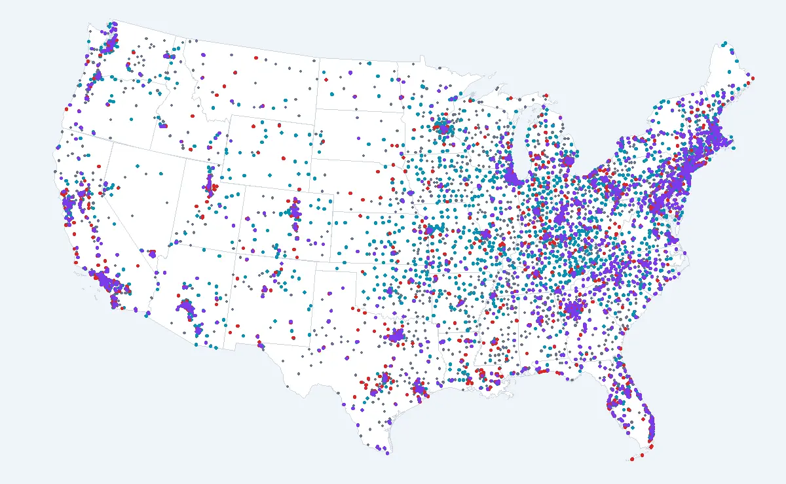

# US County Distance to Addiction Treatment (2026)

[](https://doi.org/10.5281/zenodo.23338215)




How far does someone have to travel to reach addiction treatment in each U.S. county? SAMHSA's locator lists where programs are, but not that distance. This dataset answers it for all 3,144 counties.

For every county we took the Census 2020 mean center of population and measured the straight-line distance to the closest program offering medical detox, methadone (opioid treatment program), buprenorphine and residential care, plus counts of programs inside the county.

- Interactive map, county pages and state reports: [findrehabmap.com](https://findrehabmap.com)
- Methodology: [findrehabmap.com/about](https://findrehabmap.com/about/)
- State ranking: [findrehabmap.com/treatment-deserts/states](https://findrehabmap.com/treatment-deserts/states/)
- Also on [Hugging Face](https://huggingface.co/datasets/Nick7227/us-county-distance-to-addiction-treatment) and [Kaggle](https://www.kaggle.com/datasets/nick722/us-county-distance-to-addiction-treatment)
- Try it: [county lookup app](https://huggingface.co/spaces/Nick7227/county-distance-to-addiction-treatment)

## Headline numbers

- 18,226 treatment programs after cleaning
- 777 of 3,144 counties have no addiction treatment program inside the county line
- About 23.5 million people live in counties 30+ miles from medical detox
- Worst states for detox access (share of residents 30+ miles away): Montana 53%, Wyoming 51%, Alaska 44%, North Dakota 37%, South Dakota 37%

## Loading

```python
from datasets import load_dataset
counties = load_dataset("Nick7227/us-county-distance-to-addiction-treatment", "counties", split="train")
states = load_dataset("Nick7227/us-county-distance-to-addiction-treatment", "states", split="train")
```

Or with pandas:

```python
import pandas as pd
df = pd.read_csv("hf://datasets/Nick7227/us-county-distance-to-addiction-treatment/data/us-county-treatment-access.csv", dtype={"fips": str})
```

## Files

### `data/us-county-treatment-access.csv` (3,144 rows, one per county)

| Column | Description |
|---|---|
| `fips` | 5-digit county FIPS code (Census GEOID) |
| `state` | State name |
| `county` | County or county-equivalent name |
| `population_2024` | Census Bureau 2024 population estimate |
| `median_household_income` | ACS 2019-2023 5-year median household income (USD) |
| `facilities_in_county` | Treatment programs located inside the county after cleaning and de-duplication |
| `facilities_per_100k` | Programs per 100,000 residents |
| `detox_in_county` | Programs in county offering medical detox |
| `methadone_otp_in_county` | Opioid treatment programs (methadone) in county |
| `buprenorphine_in_county` | Programs in county tagged for buprenorphine |
| `medicaid_accepting_in_county` | Programs in county accepting Medicaid |
| `miles_to_nearest_any` | Straight-line miles from county population center to nearest program of any type |
| `miles_to_nearest_detox` | Miles to nearest medical detox |
| `nearest_detox_city` | City and state of nearest detox |
| `miles_to_nearest_methadone` | Miles to nearest methadone clinic (OTP) |
| `nearest_methadone_city` | City and state of nearest OTP |
| `miles_to_nearest_buprenorphine` | Miles to nearest listed buprenorphine provider |
| `miles_to_nearest_residential` | Miles to nearest residential program |
| `facilities_within_25mi` | Programs of any type within 25 miles of the population center |
| `pop_center_lat` | Census 2020 mean center of population, latitude |
| `pop_center_lon` | Census 2020 mean center of population, longitude |
| `url` | County page on findrehabmap.com |

### `data/state-summary.csv` (51 rows, states plus D.C.)

| Column | Description |
|---|---|
| `rank` | Rank by share of residents 30+ miles from detox (1 = worst access) |
| `state` | State |
| `share_30mi_detox` | Share of state population living in counties 30+ miles from medical detox |
| `people_30mi_detox` | People living in counties 30+ miles from detox |
| `people_30mi_methadone` | People living in counties 30+ miles from a methadone clinic |
| `counties_no_program` | Counties with no treatment program inside the county line |
| `counties` | Number of counties |
| `worst_county` | County farthest from detox |
| `worst_miles` | Miles from that county to nearest detox |
| `report_url` | State report on findrehabmap.com |

## Sources

- Program locations and services: SAMHSA FindTreatment.gov (substance use and co-occurring programs)
- County boundaries: Census cartographic boundary files 2023
- Population centers: Census 2020 centers of population
- Population: Census 2024 county estimates; income: ACS 2019-2023 5-year (table B19013)

## Cleaning

Raw locator records were cleaned before any calculation:

1. Dropped 3,764 records whose coordinates fell in a different state than their address.
2. Dropped 524 records whose point was more than 30 miles from the city they listed (checked against the Census place gazetteer).
3. Merged duplicate listings of the same program (same phone and location within half a mile). 25,939 records became 18,226.

## Limitations

- Distances are straight-line ("as the crow flies"). Driving distance is longer, especially in mountain and rural areas.
- A program counts as offering a service if SAMHSA lists it. Buprenorphine is under-counted: since the X-waiver ended in January 2023, many primary care doctors and telehealth services prescribe it without appearing in the locator.
- Programs open, close and change services. Data pulled October 7, 2026.

## License and citation

CC BY 4.0. Please credit with a link to [findrehabmap.com](https://findrehabmap.com/open-data/).

```bibtex
@misc{findrehabmap2026,
  title  = {Distance to addiction treatment for every U.S. county},
  author = {FindRehabMap},
  year   = {2026},
  url    = {https://findrehabmap.com/open-data/}
}
```

Questions or a custom cut (for example by legislative district): data@findrehabmap.com

## Files

| Path | Rows | Description |
|---|---|---|
| `data/us-county-treatment-access.csv` | 3,144 | One row per U.S. county (FIPS) |
| `data/state-summary.csv` | 51 | One row per state plus D.C., ranked by share of residents 30+ miles from detox |
| `data/states/{state}.csv` | | County rows for a single state |
| `analysis/treatment-deserts.ipynb` | | Example analysis (pandas) |

## Quick start

```python
import pandas as pd
url = "https://raw.githubusercontent.com/nickljashov90-tech/us-county-treatment-access/main/data/us-county-treatment-access.csv"
df = pd.read_csv(url, dtype={"fips": str})
df.sort_values("miles_to_nearest_detox", ascending=False).head(10)
```

## Citation

If you use this data, please credit **FindRehabMap** with a link to [findrehabmap.com](https://findrehabmap.com). DOI: [10.5281/zenodo.23338215](https://doi.org/10.5281/zenodo.23338215) (always resolves to the latest version). A `CITATION.cff` file is included; GitHub shows a "Cite this repository" button.

## License

Data: [CC BY 4.0](https://creativecommons.org/licenses/by/4.0/). Underlying sources: SAMHSA FindTreatment.gov (public domain, U.S. government) and U.S. Census Bureau.
